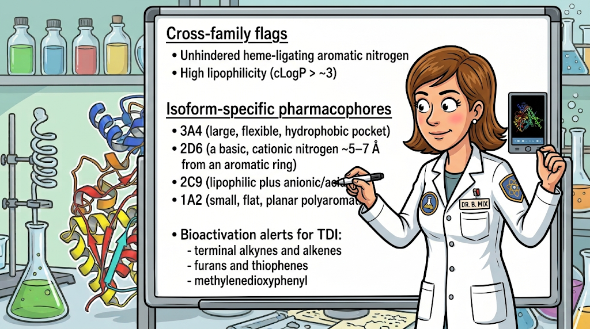
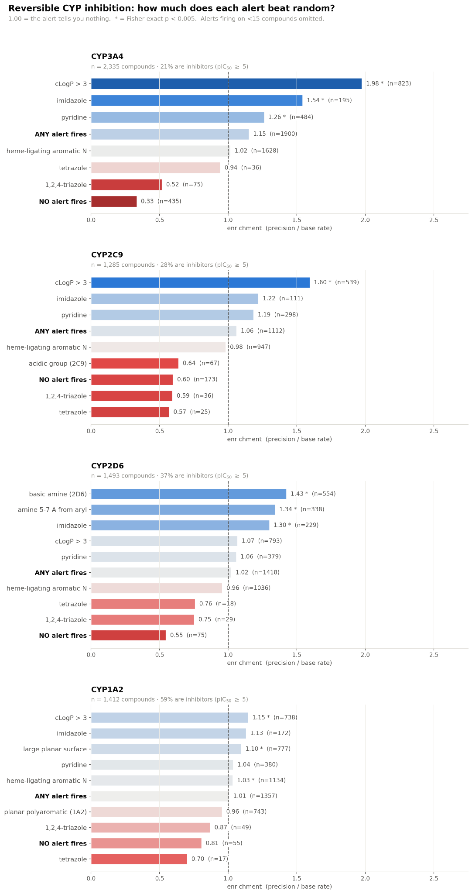
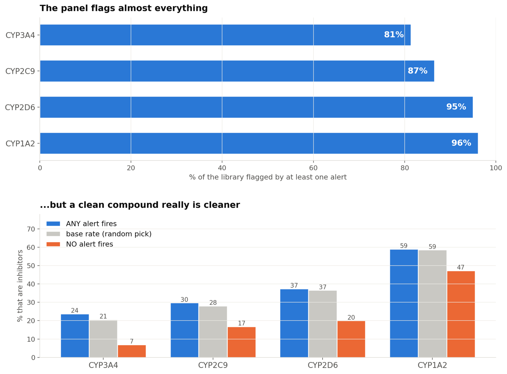
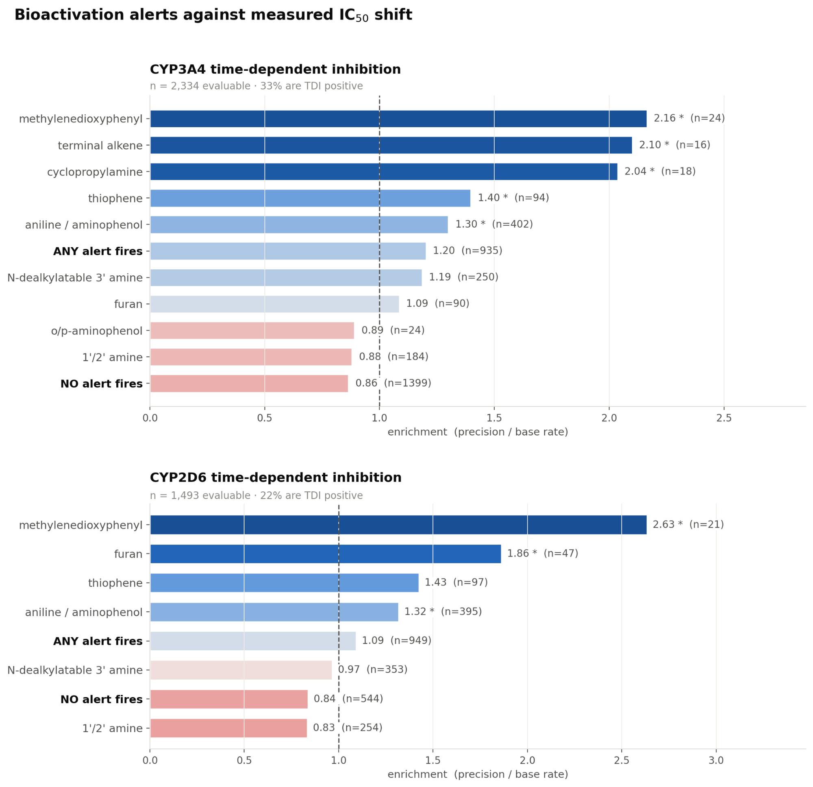
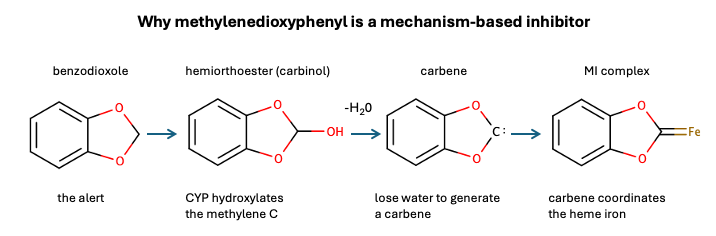
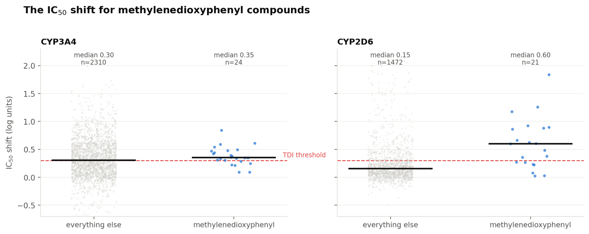

Source: https://openadmet.ghost.io/do-our-cyp-structural-alerts-actually-work/ | Retrieved: 2026-09-07T13:58:04.102651+00:00

# Do Our CYP Structural Alerts Actually Work?

Medicinal chemistry groups frequently rely on mental lists of structural alerts to predict CYP inhibition, yet these heuristics are rarely tested against real data. What happens when we evaluate these alerts using 7,800 experimental measurements?

**Author:** Pat Walters

Every medicinal chemistry group I've worked with has a mental list of substructures that "cause CYP inhibition." Someone adds an imidazole to a molecule, and someone else says, "That's going to nail 3A4," and the compound gets deprioritized. This happens dozens of times a week across the industry. These heuristics feel authoritative: they have mechanisms attached, they appear in review articles, and they get printed on cheat sheets and taped to monitors.

What almost never happens is checking them against data.

The training set for [OpenADMET's CYP inhibition blind challenge](https://openadmet.ghost.io/announcing-openadmets-cyp-inhibition-blind-challenge/) gives us a chance to do exactly that. In this post, I'm going to take a standard set of CYP structural alerts, run them across ~7,800 measured IC50 values spanning four isoforms, and ask a simple question: **when the alert fires, how often is it right?**

Spoiler: often enough to fool you, and almost never often enough to be useful. Those turn out to be two different questions.

## **Why We Care About CYP Inhibition**

The cytochrome P450 family handles the bulk of Phase I drug metabolism, and four isoforms, CYP3A4, CYP2D6, CYP2C9, and CYP1A2, account for most of it. CYP3A4 alone is implicated in the metabolism of roughly half of marketed drugs.

If your compound inhibits one of these enzymes, it changes the clearance of every co-administered drug that depends on that enzyme. That's a drug–drug interaction (DDI), and DDIs are not an academic concern. [Terfenadine](https://en.wikipedia.org/wiki/Terfenadine?ref=openadmet.ghost.io) and [cisapride](https://en.wikipedia.org/wiki/Cisapride?ref=openadmet.ghost.io) were both withdrawn over DDI-mediated cardiac events. [Mibefradil](https://en.wikipedia.org/wiki/Mibefradil?ref=openadmet.ghost.io) was on the market for about a year. For a drug that will be co-dosed with anything, such as an oncology agent, an anti-infective, or anything going into an elderly polypharmacy population, a CYP liability is a program-level risk, not a footnote.

There's a second, nastier version of the problem. **Time-dependent inhibition (TDI)** occurs when the enzyme metabolizes your compound into something that then destroys the enzyme, such as a reactive intermediate that alkylates the protein or a metabolite that coordinates the heme iron so tightly that it never lets go. Reversible inhibition washes out when the drug clears. TDI doesn't. The enzyme has to be resynthesized, which takes days, so the DDI persists long after the compound is gone and the magnitude is far larger than the *in vitro* IC50 would suggest. TDI is measured by running the IC50 twice: once with the enzyme metabolizing the compound during a preincubation, and once with metabolism absent (in the absence of NADPH). If the IC50 gets more potent when the enzyme is working, something is being bioactivated. Note that covalent inhibition isn't the only form of TDI. A compound can also be metabolized to a more potent, reversible inhibitor.

## **The Heuristics**

Because these liabilities are expensive, the field has accumulated a body of structure-based rules of thumb. Here's the CYP section of a cheat sheet a colleague and I put together from the standard reviews ([Kalgutkar 2005](https://pubmed.ncbi.nlm.nih.gov/15975040/?ref=openadmet.ghost.io), [Fontana 2005](https://pubmed.ncbi.nlm.nih.gov/16248836/?ref=openadmet.ghost.io), [Stepan 2011](https://pubmed.ncbi.nlm.nih.gov/21702456/?ref=openadmet.ghost.io)):

**Cross-family flags**

- **Simple heme-ligating aromatic nitrogen**, including imidazole, triazole, pyridine, or any sp² N that can coordinate the heme iron. Potent, often pan-CYP. The azole antifungals are the archetype.
- **High lipophilicity** (cLogP > ~3) and a large planar aromatic surface pose a broad risk, especially to 3A4.

**Isoform-specific pharmacophores**

- **3A4** (large, flexible, hydrophobic pocket). Big lipophilic molecules plus a heme-ligating nitrogen. Most prone to TDI (e.g., ketoconazole).
- **2D6** (a basic, cationic nitrogen ~5–7 Å from an aromatic ring), forming a salt bridge to Asp301/Glu216 (e.g., quinidine).
- **2C9** (lipophilic plus anionic/acidic), engaging an active-site arginine. Note the tension: an acid is *protective* for hERG and 2D6 but a liability here (e.g., sulfaphenazole).
- **1A2** (small, flat, planar polyaromatics that stack in a narrow pocket). (e.g., fluvoxamine)

**Bioactivation alerts for TDI**: terminal alkynes and alkenes; furans and thiophenes (reactive epoxides/thiolenes); methylenedioxyphenyl (MI complex); primary/secondary amines and hydrazines (nitroso → MI complex); anilines and aminophenols (quinone-imines); thioamides and thioureas; cyclopropylamines and N-dealkylation-prone tertiary amines (radical/iminium intermediates).

Two of those routes end at the same place, so it's worth naming them. A **metabolite-intermediate (MI) complex** forms when a CYP oxidizes a compound to a reactive species that then coordinates directly to the heme iron, as a carbene from a benzodioxole or a nitroso from an amine. The enzyme has poisoned itself with its own product, still sitting in the active site. The complex is called quasi-irreversible because it's a coordinate bond rather than a covalent one, and a strong oxidant will break it in a test tube. In a patient, it doesn't come apart; the enzyme has to be resynthesized.

These are all mechanistically reasonable. Every one has a paper behind it. The question is whether they're *predictive*.

## **The Data**

[OpenADMET](https://openadmet.org/?ref=openadmet.ghost.io) has been generating large, uniformly measured ADMET datasets and releasing them publicly, which is genuinely useful in a field where most of the data lives behind firewalls. The CYP data was generated by [Octant](https://www.octant.bio/?ref=openadmet.ghost.io) and covers the four isoforms that drive most small-molecule metabolism: CYP3A4, CYP2C9, CYP2D6, and CYP1A2. Three are read out by fluorescence with masked probes in 1536-well plates; CYP2D6 is analyzed by label-free acoustic-ejection mass spec with dextromethorphan as the substrate, because the fluorescent probes behave poorly on that isoform (in our hands).

The part that makes this dataset unusual is the assay design. Rather than running a standard IC50 and following up on suspicious compounds, the protocol **collects a TDI curve for every compound by default**. Each compound is preincubated twice with the recombinant enzyme: once with NADPH, allowing the enzyme to turn over and bioactivate the compound, and once without NADPH, to prevent that. The NADPH-free arm gives you clean reversible inhibition. The difference between the arms is the IC50 shift, and that's your TDI readout. Getting both arms on everything, rather than on a triaged subset, is what makes an analysis like this one possible at all.

The training set is 7,779 compound-isoform records across 6,145 molecules: 3,584 for 3A4, 1,497 for 2D6, 1,413 for 1A2, and 1,285 for 2C9.

**A note on what I did *not* do.** The challenge launches on August 17th, with a final deadline of November 3rd, and it has two tracks: pIC50 regression for direct inhibition, and classification of TDI positives at a >2-fold IC50 shift. Blind challenges only work if people stay honest about the test set. The release ships its files explicitly marked TRAIN and TEST, and everything below reads only the TRAIN files. I haven't touched the 750 held-out compounds; I'm not making predictions on them, and nothing here should give anyone an edge. I don't want to spoil the party; I just want to know whether the rules we've all been repeating for twenty years hold up.

Two data-handling decisions worth stating, because they change the answer:

**Reversible inhibition means the NADPH-free arm, and only that arm.** On CYP3A4, 1,249 compounds were run *only* with the preincubation. Their sole IC50 comes from an assay in which the enzyme was actively metabolizing the compound, so it conflates reversible potency with time-dependent inactivation. Those compounds have no direct-inhibition value in the release, and it's worth seeing what you'd get if you ignored that and pooled them in anyway: on the preincubation arm they look **66.8% active**, which would put the 3A4 inhibitor rate at 36.7% instead of the correct 20.6%. Nearly half of that apparent inhibition is the enzyme being destroyed, not bound.

**A compound with no fitted shift is not a TDI negative.** It's a compound that was never evaluated, and this one still has to be handled by hand. All 1,249 of those preincubation-only CYP3A4 compounds carry a TDI label of False, and **every one of the 764 TDI positives sits in the group that has both arms**. A compound with one arm has no shift to measure, so it was defaulted to negative rather than measured as one. Keeping those rows would drop the 3A4 TDI base rate from 32.7% to 21.3% and inflate every precision figure below by roughly half. The TDI analysis is restricted to compounds that actually have a shift. For the TDI label itself, I used the flag that ships with the dataset, a shift of at least 0.3 log units that also passes a significance test, which is the same >2-fold criterion the challenge uses for scoring.

I also skipped TDI entirely for 1A2 and 2C9. Both isoforms have plenty of compounds; what they don't have are TDI positives: only 23 of 1,412 on 1A2 and 38 of 1,285 on 2C9, compared with 764 and 324 for 3A4 and 2D6. An alert firing on 3% of the 1A2 library would be expected to catch about 3% of those 23 positives, which is under one compound. Whether it lands on zero, one, or two is luck, not signal.

## **The Metric**

Precision alone is useless for comparing across isoforms, because the base rates differ wildly. In this dataset, 59% of the CYP1A2 compounds are inhibitors, but only 21% of the CYP3A4 compounds are. An alert with 50% precision is *below random* on 1A2 and excellent on 3A4.

So everything below is reported as **enrichment**, with higher values indicating greater enrichment.

enrichment = precision / base rate

where the base rate is the fraction of actives you'd get picking a compound at random from that isoform's set. **1.00 means the alert tells you nothing.** Every alert also gets a one-sided Fisher exact test; with ~10 alerts per panel, I'm treating p < 0.005 as the bar.

One consequence is worth having in mind before the tables start. The largest enrichment arithmetically available is 1/base rate, which is 1.71 on 1A2, 2.73 on 2D6, 3.57 on 2C9, and 4.85 on 3A4. No alert on 1A2 can score above 1.71 no matter how good it is, so read that column against a lower ceiling than the rest.

## **Reversible Inhibition: The Heuristics Mostly Don't Work**

*Figure 1. Enrichment of each alert for reversible inhibition, by isoform. 1.00 = no information.*

Let's start with the headline, and with a trap. As shown in Figure 1, across the four isoforms there are 30 alert/isoform combinations for reversible inhibition, and **8 of them are right more than half the time**. The best is cLogP > 3 on CYP1A2, correct on 67.2% of the 738 compounds it flags. That sounds like a rule worth having.

It isn't. CYP1A2 in this collection is 58.6% inhibitors, so being right 67.2% of the time is an enrichment of **1.15**. Seven of those eight alerts are on 1A2, and they're there because the coin is weighted, not because the alerts are good. Judged on enrichment instead, **12 of the 30 combinations are *anti*-predictive**, firing preferentially on compounds that aren't inhibitors, and the best result anywhere in the grid is 1.98.

Some specifics:

**The heme-ligating aromatic nitrogen, the flagship pan-CYP heuristic, is uninformative on all four isoforms.** Enrichment is 1.03 (1A2), 0.98 (2C9), 0.96 (2D6), and 1.02 (3A4), while firing on 69–80% of every library. This is what a rule that does nothing looks like. The mechanism isn't wrong (azoles really do coordinate heme iron), but the rule is far too permissive. Any aromatic nitrogen is not a heme ligator; geometry and sterics matter, and "has a pyridine somewhere" doesn't capture that. The narrower **imidazole** subset does work, enriching 1.13–1.54 across all four and climbing on every isoform as you raise the potency bar. That's the useful signal buried inside the useless one.

**The isoform-specific pharmacophores are a mixed bag, and one of them runs backward.** The 2D6 basic amine alert is the star of the analysis: enrichment 1.43, p = 9×10⁻²², 53% recall, and the topological version (basic amine 5–7 Å from an aromatic ring) delivers 1.34. This is the one structural heuristic that clearly earns its place, and it works exactly where the crystallography says it should. Meanwhile, the 2C9 acidic-group alert enriches at **0.64**, 12 actives out of 67 flagged against 28% expected. Acids in this set are *less* likely to inhibit 2C9 than a random compound, which is the opposite of what the heuristic predicts. (Hold that thought; it turns out not to be an acid effect at all.) And the planar polyaromatic alert, designed specifically for 1A2, scores 0.96 on 1A2, and gets worse rather than better as you demand more potency.

### **The Property Flags Do the Work the Substructures Were Supposed to Do**

Something worth pausing on: this panel isn't only a set of substructure alerts. Four of its alerts are physicochemical: cLogP > 3, MW > 500, more than three aromatic rings, and a topological measure of how far a basic amine sits from an aromatic ring. They're bolted onto the same screening output as the substructure patterns; they fire the same way, and in practice nobody distinguishes them when triaging a list. They should be scored separately, because they behave completely differently.

**Lipophilicity is the strongest single predictor in the whole reversible-inhibition analysis.** cLogP > 3 enriches 1.98 on 3A4 (p = 1×10⁻⁶⁷) and 1.60 on 2C9 (p = 1×10⁻²⁹), larger than any substructure alert on any isoform. And it isn't a uniform effect; it tracks how much the actives and inactives actually differ in cLogP:

| Isoform | median cLogP, actives | inactives | Pearson correlation with activity | enrichment |
| --- | --- | --- | --- | --- |
| CYP3A4 | 3.41 | 2.47 | 0.39 | 1.98 |
| CYP2C9 | 3.39 | 2.63 | 0.35 | 1.60 |
| CYP1A2 | 3.21 | 2.81 | 0.17 | 1.15 |
| CYP2D6 | 3.14 | 3.06 | 0.06 | 1.07 |

That ordering is the pharmacology showing through. 3A4's big hydrophobic pocket and 2C9's lipophilic-anionic site are driven by greasiness; 2D6 is driven by a specific salt bridge, so lipophilicity barely registers there. The cheat sheet says exactly this, "broad risk, 3A4 especially," and it's the one heuristic in the set that survives contact with the data intact.

It also explains where the one good structural alert lives. 2D6 is the isoform where cLogP is essentially uncorrelated with activity, and it's the only isoform where a substructure beats it. Where greasiness has nothing to say, recognition chemistry does.

The uncomfortable follow-on is that lipophilicity may be *all* that most other alerts measure. Lipophilic compounds are lipophilic for structural reasons (more rings, more halogens, fewer polar groups), so any substructure that correlates with greasiness will look predictive. To check, I refit each alert in a logistic model with cLogP as a covariate and asked which ones still carried an independent signal. Most don't. The 2C9 acidic-group alert, which looked so striking at 0.64, drops to a coefficient of −0.53 with **p = 0.14**. Split the 2C9 set by cLogP and, in the bands with enough acids to compare, acids track non-acids closely: 10.5% vs 8.7% active at cLogP 1–2, and 37.5% vs 38.1% at cLogP 3–4. It was never an acid effect. It was acids being less lipophilic on the isoform where lipophilicity dominates. The pan-CYP heme-ligating nitrogen alert likewise carries nothing independent on 2C9, 2D6, or 3A4. What *does* survive adjustment at p < 0.005 is a short list: the 2D6 basic amine (p = 2×10⁻²², the strongest result in the study by this measure), its topological variant, imidazole on 2D6 and 3A4, and, interestingly, the aromatic-ring count on 1A2. Those encode real recognition chemistry. The rest are lipophilicity in a costume.

**Molecular size, on the other hand, is simply untestable here, and I want to be clear that it's untested rather than disproven.** The MW > 500 flag fires on 7 to 10 compounds per isoform, between 0.3% and 0.7% of each library. The median compound in this collection is around MW 344, so a size cutoff of 500 leaves almost nothing to grade. Worse, on CYP3A4 the problem compounds itself: of the 91 compounds above MW 500 in the full 3A4 set, **84 have no NADPH-free arm** and are therefore absent from the inhibition endpoint, leaving 7. Those excluded compounds had a median MW of 423 against 344 for the ones with both arms, so the design decision that makes the inhibition endpoint clean also removes nearly all of the large chemistry. The 2.08 enrichment you'll see for MW > 500 in the underlying results table rests on 3 active compounds and p = 0.16. Don't quote it in either direction; this dataset can't speak to whether size matters for CYP inhibition.

*Figure 2. Panel coverage and inhibitor rate when ANY alert fires vs. base rate vs. NO alert.*

Here's the part that I think matters most for practice. The alert panel flags **81–96% of every library**. When *any* alert fires, enrichment is 1.01, 1.06, 1.02, and 1.15 across the four isoforms, which is statistically indistinguishable from picking at random. For CYP1A2, the panel flags 96% of the library and is correct 59.0% of the time, while random guessing is correct 58.6% of the time. That is not actionable.

But look at the other end. When *no* alert fires, enrichment drops to 0.33 (3A4), 0.55 (2D6), 0.60 (2C9), 0.81 (1A2). The 435 CYP3A4 compounds that trip nothing are 6.9% active, compared with a base rate of 20.6%, representing a threefold depletion. **The panel has real value, but it's running in the wrong direction.** It's a decent negative filter and a near-useless positive one. "This compound has no alerts" is informative. "This compound has an alert" is not, because so does everything else.

The exception is CYP1A2, where the panel clears only 55 of 1,412 compounds. Even a good negative filter needs somewhere to put what it clears, and on the isoform where nearly everything inhibits, there's almost no clean space left to point at.

## **Time-Dependent Inhibition: This Is Where Structure Wins**

*Figure 3. Bioactivation alerts scored against the measured IC50 shift, CYP3A4 and CYP2D6.*

Now flip to TDI and the picture changes completely. These are the alerts that encode bioactivation chemistry: specific reactions producing specific reactive species. They behave like real predictions:

| Alert | CYP3A4 | CYP2D6 |
| --- | --- | --- |
| methylenedioxyphenyl | 2.16 (p = 1×10⁻⁴) | 2.63 (p = 4×10⁻⁴) |
| terminal alkene | 2.10 (p = 3×10⁻³) | 0.51 (n = 9) |
| cyclopropylamine | 2.04 (p = 3×10⁻³) | 2.30 (n = 6) |
| furan | 1.09 (ns) | 1.86 (p = 2×10⁻³) |
| thiophene | 1.40 (p = 5×10⁻³) | 1.43 (p = 0.018) |
| aniline/aminophenol | 1.30 (p = 4×10⁻⁶) | 1.32 (p = 9×10⁻⁵) |

Four alerts here are right more than half the time on a double-digit number of compounds, and unlike the reversible-inhibition grid they manage it against base rates of 33% and 22%, so precision and enrichment agree with each other for once. All four are bioactivation motifs. The specificity is real too; furan gives a nearly 2-fold TDI signal on 2D6 and nothing at all on 3A4, which is the kind of isoform asymmetry you'd expect if the alert is capturing genuine metabolic chemistry rather than a generic property.

The failures are informative in the same way. Both amine alerts (N-dealkylatable tertiary amines and primary/secondary amines) work modestly on 3A4 (1.19, 0.88) and fail outright on 2D6 (0.97, 0.83). 2D6 *loves* basic amines as reversible binders; that doesn't make them bioactivation substrates.

## **The Methylenedioxyphenyl Group**

The strongest single alert in this entire analysis is methylenedioxyphenyl (benzodioxole), and it's worth understanding why, because it's a textbook case of an alert that deserves its reputation.

*Figure 4. The methylenedioxyphenyl bioactivation route to a metabolite-intermediate complex.*

The CYP hydroxylates the methylene carbon sitting between the two oxygens, which is the same C–H abstraction it performs on any activated methylene. But this particular carbinol is flanked by two oxygens, so it dehydrates readily. What's left after the loss of water is a **carbene**. A carbene is an outstanding σ-donor ligand for Fe(II), and the resulting metabolite-intermediate (MI) complex is essentially irreversible on any pharmacologically relevant timescale. The enzyme doesn't come back; it has to be resynthesized. This mechanism has been implicated in time-dependent CYP2D6 inhibition by [MDMA](https://www.sciencedirect.com/science/article/abs/pii/S1382668999000071?via%3Dihub&ref=openadmet.ghost.io).

This is the distinction between a reversible inhibitor and a mechanism-based one, and it's why the two-arm assay matters. A benzodioxole can look unremarkable in the NADPH-free arm and be a serious problem once the enzyme is allowed to turn over.

*Figure 5. IC50 shift for methylenedioxyphenyl compounds vs. everything else.*

The data bear this out. On CYP2D6, the 21 methylenedioxyphenyl-containing compounds have a median IC50 shift of 0.60 log units against 0.15 for everything else, and 12 of 21 cross the TDI threshold. On CYP3A4, 17 of 24 score positive, though the margin is thinner there: median 0.35 against 0.30. The 3A4 benzodioxoles are clearing the significance test on many small, reproducible shifts rather than on a few large ones, which is a weaker claim than the 2D6 result even though the enrichments look similar.

Note that the alert is not clean even where it works. Seven of the 24 show no significant shift on 3A4, and nine of the 21 don't on 2D6. Having the substructure is necessary for this mechanism, not sufficient. The methylene has to be accessible, the compound has to actually reach the active site, and the competing metabolic pathways have to be slow enough. But a 2.6-fold enrichment on a real endpoint is a rule I'd act on.

The other thing to notice: the 3A4 TDI panel, taken as a whole, recalls only **48.2%** of the positives. More than half of the time-dependent inhibitors in this dataset trip no alert at all. The alerts that work, work; they just don't cover the space.

## **What I Take Away From This**

Most of these heuristics carry no information. Twelve of the thirty reversible-inhibition alert/isoform combinations are anti-predictive, and the eight that beat 50% precision do it almost entirely on the one isoform where 59% of compounds are inhibitors anyway. The single most-cited rule in the set, heme-ligating aromatic nitrogen, is indistinguishable from noise on all four isoforms. The alert designed for 1A2 doesn't work on 1A2, and the one designed for 2C9 measures lipophilicity rather than acidity. The best predictor of reversible CYP inhibition we found was cLogP, and once you control for it most of the substructure alerts stop predicting anything.

If there's one number to carry out of this, it's 67.2% precision at an enrichment of 1.15. Any metric that calls that a good rule is the wrong metric.

I want to be careful about what this does and doesn't show. These alerts were never presented as classifiers; the cheat sheet itself says "enrichment heuristics for prioritizing assays, not verdicts." A rule that flags a compound for testing is doing its job even at 30% precision. And this is one dataset, one chemical series distribution, and one set of assay conditions. Base rates of 21–59% mean it's already heavily enriched for CYP-active chemistry, which compresses the achievable enrichment; on 1A2 nothing could score above 1.71 even in principle. Where an alert fails, the underlying mechanism may be perfectly sound, and the rules are simply too broad. Heme-ligating nitrogen versus imidazole is exactly that case, and it suggests the fix is better patterns rather than abandoning the idea.

But the practical implication stands. If you're using these alerts to decide which compounds to make, you're mostly adding noise. Ninety-plus percent of your library trips something. The information content is in the small number of compounds that trip *nothing*, and in the handful of bioactivation motifs that predict TDI.

The reason we've been running on heuristics for two decades is that we never had the data to do better. A rule of thumb is what you build when you have twenty literature examples and an intuition. It is not what you'd build if you had 7,800 uniformly measured IC50 values sitting in a CSV.

Now we're starting to. That's what makes efforts like OpenADMET worth paying attention to. A public dataset of this size, measured consistently, with a TDI curve on every compound rather than on a triaged subset, is the raw material for models that can capture what a SMARTS pattern fundamentally can't: that the same imidazole is a problem in one molecular context and fine in another, that lipophilicity and substructure interact, that 2D6 and 3A4 want different things.

And the blind challenge is the other half of it. Retrospective analyses like this one are easy to fool yourself with: I chose the activity cutoff, I chose which compounds to exclude, and I did it all with the answers in front of me. A held-out test set that nobody has seen is the only real check on whether a model has learned chemistry or learned the dataset. The [CYP challenge](https://openadmet.ghost.io/announcing-openadmets-cyp-inhibition-blind-challenge/) opens on August 17th and runs to November 3rd, with tracks for both pIC50 prediction and TDI classification. Given how the alerts performed here, the bar to clear is low. Somebody should go clear it.

We don't need better rules of thumb. We need more datasets like this one, and the models we can build on top of them.

## **Acknowledgements**

I'd like to thank Mark Murcko, Hakan Gunaydin, Matt Daniels, Steven Richards, Hugo MacDermott-Opeskin, Jon Swain, Naomi Handly, and Lauren Orr for their helpful feedback on this post. I'd also like to thank everyone at Octant who helped generate this data, and the OpenADMET community for their continued enthusiasm.

## **Contributions**

I conceived the study, ran the experiments, and wrote the initial draft. Claude, Gemini, and Grammarly helped me to clean up the text. Claude audited and reformatted my code. It also improved the figures. Gemini made the cartoon.

## **References**

1. Stepan AF, Walker DP, Bauman J, Price DA, Baillie TA, Kalgutkar AS, Aleo MD. Structural alert/reactive metabolite concept as applied in medicinal chemistry to mitigate the risk of idiosyncratic drug toxicity: a perspective based on the critical examination of trends in the top 200 drugs marketed in the United States. *Chem Res Toxicol.* 2011;24(9):1345-1410. [PMID 21702456](https://pubmed.ncbi.nlm.nih.gov/21702456/?ref=openadmet.ghost.io)
2. Kalgutkar AS, Gardner I, Obach RS, et al. A comprehensive listing of bioactivation pathways of organic functional groups. *Curr Drug Metab.* 2005;6(3):161-225. [PMID 15975040](https://pubmed.ncbi.nlm.nih.gov/15975040/?ref=openadmet.ghost.io)
3. Kalgutkar AS, Soglia JR. Minimising the potential for metabolic activation in drug discovery. *Expert Opin Drug Metab Toxicol.* 2005;1(1):91-142. [PMID 16922655](https://pubmed.ncbi.nlm.nih.gov/16922655/?ref=openadmet.ghost.io)
4. Fontana E, Dansette PM, Poli SM. Cytochrome P450 enzymes mechanism based inhibitors: common sub-structures and reactivity. *Curr Drug Metab.* 2005;6(5):413-454. [PMID 16248836](https://pubmed.ncbi.nlm.nih.gov/16248836/?ref=openadmet.ghost.io)
5. Murray M. Mechanisms of inhibitory and regulatory effects of methylenedioxyphenyl compounds on cytochrome P450-dependent drug oxidation. *Curr Drug Metab.* 2000;1(1):67-84. [PMID 11467081](https://pubmed.ncbi.nlm.nih.gov/11467081/?ref=openadmet.ghost.io)
6. Ortiz de Montellano PR, ed. *Cytochrome P450: Structure, Mechanism, and Biochemistry.* Springer; 3rd ed. 2005 (4th ed. 2015). [doi:10.1007/b139087](https://link.springer.com/book/10.1007/b139087?ref=openadmet.ghost.io)
7. Rowland P, Blaney FE, Smyth MG, Jones JJ, Leydon VR, et al. Crystal structure of human cytochrome P450 2D6. *J Biol Chem.* 2006;281(11):7614-7622. [PMID 16352597](https://pubmed.ncbi.nlm.nih.gov/16352597/?ref=openadmet.ghost.io)
8. Williams PA, Cosme J, Ward A, Angove HC, Matak Vinkovic D, Jhoti H. Crystal structure of human cytochrome P450 2C9 with bound warfarin. *Nature.* 2003;424(6947):464-468. [PMID 12861225](https://pubmed.ncbi.nlm.nih.gov/12861225/?ref=openadmet.ghost.io)
9. Ekroos M, Sjogren T. Structural basis for ligand promiscuity in cytochrome P450 3A4. *Proc Natl Acad Sci USA.* 2006;103(37):13682-13687. [PMID 16954191](https://pubmed.ncbi.nlm.nih.gov/16954191/?ref=openadmet.ghost.io)
10. Sansen S, Yano JK, Reynald RL, Schoch GA, Griffin KJ, Stout CD, Johnson EF. Adaptations for the oxidation of polycyclic aromatic hydrocarbons exhibited by the structure of human P450 1A2. *J Biol Chem.* 2007;282(19):14348-14355. [PMID 17311915](https://pubmed.ncbi.nlm.nih.gov/17311915/?ref=openadmet.ghost.io)
11. Ballatore C, Huryn DM, Smith AB 3rd. Carboxylic acid (bio)isosteres in drug design. *ChemMedChem.* 2013;8(3):385-395. [PMID 23361977](https://pubmed.ncbi.nlm.nih.gov/23361977/?ref=openadmet.ghost.io)

---

*The complete analysis, including the notebook, screening code, and per-alert statistics, is now available on* [*GitHub*](https://github.com/OpenADMET/CYP_alerts_blog_post?ref=openadmet.ghost.io)*.*

We would like to thank our funders for their support of OpenADMET, in particular ARPAH, Radial (part of the Astera Institute ([https://ror.org/00ydx1s47](https://ror.org/00ydx1s47?ref=openadmet.ghost.io))), Schrödinger Inc, and the Gates Foundation.  We would also like to thank our partners Enamine, HuggingFace, OpenEye, CDD Vault, Discovery Life Sciences, and the beamline staff at NSLS-II for their support.

This work is supported by the Advanced Research Projects Agency for Health (ARPA-H) under AVOID-OME, and Award Number 1AY1AX000035. The contents are those of the authors. They may not reflect the policies of the Department of Health and Human Services or the U.S. government. The content is solely the responsibility of the authors and does not necessarily represent the official views of the Advanced Research Projects Agency for Health.
