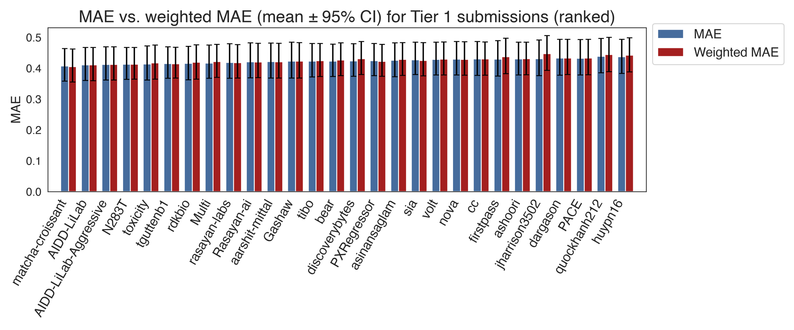
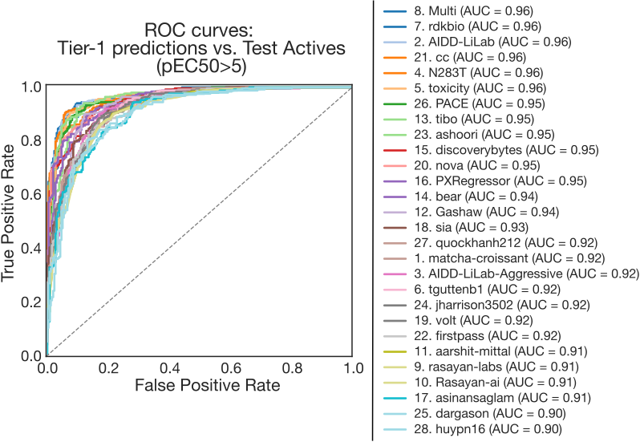
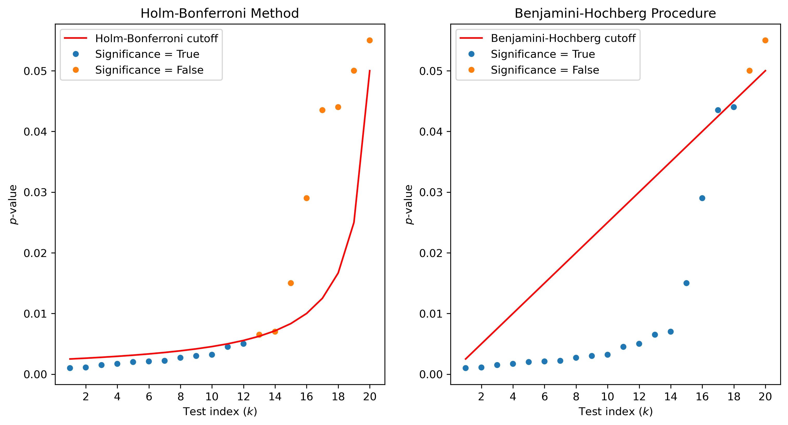

Source: https://openadmet.ghost.io/dont-look-back-in-error-what-we-learned-predicting-pxr-induction-part-i/ | Retrieved: 2026-09-07T13:58:07.462330+00:00

# Don’t Look Back in Error: What we learned predicting PXR induction (Part I)

Exploring the limits of ligand-based ML models in predicting PXR induction, based on key learnings from our recent blind challenge.

And so PXR can't wait, She knows it's too late as we're predictin' on by, Her induction slides away, "But don't look back in Error," I heard you say.

**Authors:** [Maria Castellanos](mailto:maria.castellanos@omsf.io), [Jon Swain](mailto:jon.swain@omsf.io) and [Hugo MacDermott-Opeskin](mailto:hugo.macdermott-opeskin@omsf.io)  
**DOI:** [https://doi.org/10.5281/zenodo.22103683](https://doi.org/10.5281/zenodo.22103683?ref=openadmet.ghost.io)

Induction of metabolism by unintended PXR (pregnane X receptor) agonism is typically discovered during mid- to late-stage lead optimization and can be catastrophic to a drug discovery program. PXR acts as a master xenobiotic sensor, triggering the upregulation of critical Cytochrome P450 (CYP) enzymes, most notably CYP3A4, which metabolizes nearly 50% of all marketed drugs.

Because PXR represents a significant liability that can consume substantial time and resources, it is a prime target for early ADMET prediction. Reliable early-stage predictions enable drug discovery teams to prioritize compounds with the highest likelihood of preclinical success. With this goal in mind, we launched our second challenge of the year, focused on PXR Induction, running from March 17th to July 1st, 2026. We tasked participants with predicting functional activity (**Activity Track**) and modeling protein-ligand structures (**Structure Track**), and we released data for more than 11,000 compounds.

We were blown away by the community's response! Over 350 participants competed in the Activity Track, and nearly 100 teams joined the Structure Track. (If you missed the initial recap, be sure to read [our previous blog post](https://openadmet.ghost.io/its-the-end-of-the-pxr-challenge-as-we-know-it-and-i-feel-fine/) for a full breakdown of how the competition unfolded!)

Now that the dust has settled, we’re excited to dive into the methodologies, error analyses, and key takeaways from our top-performing teams. In Part 1 of this series, we focus on the Activity Track, with Part 2 covering the Structure Track coming soon. Let's get into it!

# The Challenge: Predicting activity across structural cliffs

Predicting PXR activity early in the drug discovery pipeline requires balancing accuracy for active compounds with performance on a much larger set of inactive compounds. In this track, participants were given a traditional regression task: predicting $\text{pEC}\_{50}$ induction values for a test set, based on the values from the training set. Although the task sounds straightforward on paper, both the training and test sets contained significant activity cliffs, which pose a major hurdle for simple machine learning models (see [here](https://pubs.acs.org/acsodf/article/4/11/14360/605355/Evolving-Concept-of-Activity-Cliffs?ref=openadmet.ghost.io) for reference).

Overall, we observed impressive performance among participating teams. In fact, the top 28 entries were statistically indistinguishable from one another. To reflect this, we grouped submissions into a "tier" system: Tier 1 comprises the contiguous block of top-ranked entries whose performance was not statistically distinct from that of the top-ranked model, while Tier 2 begins with the first entry that showed a statistically significant difference in performance.

Analyzing the methodologies of Tier-1 teams revealed several clear trends that contributed to their success in this blind challenge: a shift away from single end-to-end Chemprop models toward diverse ensembles, strategic integration of single-concentration auxiliary data, and custom post-processing and architecture engineering to handle the inactive tail of the activity distribution.

Below, we break down these strategies and explore what they reveal about the current limits and future of predictive PXR modeling.

## Summary of models and training strategies of Tier 1 teams

The interactive table below summarizes the methodologies used by Tier-1 participants across the following key parameters:

• **Primary Models**: The model architectures used.

• **Ensembles**: The total number of models grouped together.

• **3D Features**: Whether 3D spatial representations or conformers were incorporated.

• **Featurization**: The molecular descriptor and representation strategies used.

• Auxiliary Data: Usage of **single-concentration**, **counter-screening**, **Phase 1 labels, or other** additional data provided by the organizers.

• **External/Proprietary Data**: Incorporation of public datasets or proprietary external data.

• Training & Optimization: Strategies for **data augmentation**, hyperparameter optimization (**HPO**), and **validation**.

• **Agentic Workflows**: Usage of autonomous or semi-autonomous workflows (e.g., LLM-driven agents) *for model improvement* during development. Note that the use of code writing helpers (e.g., Claude, Gemini) were considered universal baseline tools and are excluded here.

**Table 1.** Summary of methods participants used in the Activity Track. Hover over ✓ / ✗ / — symbols and numbers in the condensed columns to see more details.

| Rank | Team | Primary Models | Ens. | 3D | Featurization | Conc. | Counter | Ph1 | Other | Ext. | Prop. | Aug. | HPO | Valid. | Agent |
| --- | --- | --- | --- | --- | --- | --- | --- | --- | --- | --- | --- | --- | --- | --- | --- |
| 1 | **matcha-croissant** | Multitask GNN, proxy-SVR GNN, [Chemprop, CheMeleon, Unimol2, TabICL, SVR] | 2 | ✓ | Molecular graph + precomputed descriptors | ✓ | — | ✓ | — | ✓ | ✓ | ✓ | ✓ | ✓ | — |
| 2 | **AIDD-LiLab** | Uni-Mol v2, RBF SVR, gated 5-modality MLP, LGBM, PharmHGT-v2,multi-kernel SVR, histgradientboosting classifier | 15+ | ✓ | Uni-Mol v2 3D, ProLIF IFP, ESP-DNN partial charges, 3D Mordred, commercial MOE descriptors, Boltz cofold embeddings | ✓ | ✓ | ✓ | — | ✓ | ✗ | ✓ | — | ✓ | — |
| 3 | **AIDD-LiLab-Aggressive** | Same as #2 | 15+ | ✓ | Same as #2; 3-way SVR adds ChemFM-3B/CLAMP/da4mt | ✓ | ✓ | ✓ | — | ✓ | ✗ | ✓ | — | ✓ | — |
| 4 | **N283T** | ChemProp D-MPNN, KERMT graph transformer, MoLFormer-c3, GatedGCN, AttentiveFP, tabular core (CheMeleon+Mordred+RDKit+Boltz-2+pred log2fc); Boltz-2 structural | 9 | ✓ | Predicted log2fc, CheMeleon, Mordred, RDKit, Boltz-2 pocket pLDDT/PAE/PDE + scalars, pose-Jazzy | ✓ | — | ✓ | — | ✗ | ✗ | ✗ | ✓ | ✓ | — |
| 5 | **toxicity** | Chemprop, TabPFN V3 (multi-task) | 2+ | ✗ | RDKit 2D descriptors | ✓ | ✓ | ✓ | ✓ | ✓ | ✓ | ✗ | ✗ | ✓ | — |
| 6 | **tguttenb1** | Chemprop, AttentionFP, Uni-Mol, TorchMD, TabPFN, LGBM, XGBoost (stacking layer) | 7+ | ✓ | RDKit, ECFP4/6 PCA, Mol2Vec, GNN embeddings, nearest-neighbor, conformer geometry | ✓ | — | — | — | ✗ | ✗ | ✓ | — | ✓ | — |
| 7 | **rdkbio** | Uni-Mol-2 (84M), LightGBM, TabICL, TabM, ChemBERTa, CheMeleon | 6+ | ✓ | Mordred, Morgan-count fingerprints, LM embeddings (ChemBERTa, CheMeleon) | ✓ | ✓ | ✓ | ✗ | ✗ | ✗ | — | ✗ | ✓ | — |
| 8 | **Multi** | Multiple 2D graph-based models + Uni-Mol | 2+ | ✓ | 2D molecular graphs, 3D molecular representations (Uni-Mol) | ✓ | ✓ | ✓ | — | — | — | — | — | ✓ | — |
| 9 | **rasayan-labs** | CheMeleon (HTS-pretrained + structure-fused), MolE, UniMol, physchem/ADMET GBMs | 12 | ✓ | CheMeleon-HTS embeddings + pocket scores + QVS interaction energies, MolE, UniMol embeddings, physchem/ADMET descriptors | ✓ | ✓ | ✓ | — | ✗ | ✗ | ✓ | — | ✓ | — |
| 10 | **Rasayan-ai** | Same model as #9 (base cascade, no Tobit) | 12 | ✓ | Same | ✓ | ✓ | ✓ | — | ✗ | ✗ | ✓ | — | ✓ | — |
| 11 | **aarshit-mittal** | Same as #9 + experimental post-hoc cliff-routing correction channel | 12 | ✓ | Same | ✓ | — | ✓ | — | ✗ | ✓ | ✓ | — | ✓ | — |
| 12 | **Gashaw** | Chemprop D-MPNN, MultitaskMPNN, UniMol | 3 | ✓ | RDKit 61 descriptors + D-MPNN graph; 3D conformers | ✓ | ✓ | ✓ | ✓ | ✗ | ✗ | — | — | ✓ | — |
| 13 | **tibo** | LightGBM, ChemProp, TabPFN, TabICL, CheMeleon | 2+ | ✗ | Structural fingerprints, physchem descriptors, learned embeddings (ChemProp/CheMeleon) | ✓ | ✗ | ✓ | — | ✗ | ✗ | ✓ | ✓ | ✓ | ✓ |
| 14 | **bear** | Chemprop, CheMeleon (multi-task), TabICL, TabPFN | 3 | ✓ | 30 RDKit 2D features, co-folding physics/binding scores, xTB/CPCM-x permeability features | — | — | ✓ | — | ✓ | ✗ | — | — | ✓ | — |
| 15 | **discoverybytes** | Chemprop, Uni-Mol, MolE, LightGBM | 3 | ✓ | SMILES, 3D molecular representations (Uni-Mol), learned embeddings (MolE) | — | — | ✓ | — | ✗ | ✗ | ✓ | — | ✓ | ✓ |
| 16 | **PXRegressor** | Transformer-based denoising diffusion model + FC property predictor head | 10 | ✓ | Ensemble of 3D all-atom conformers (via Schrödinger LigPrep) | ✓ | ✓ | ✓ | ✓ | ✗ | ✗ | — | ✓ | ✓ | — |
| 17 | **asinansaglam** | LightGBM (GBDT), ChemProp D-MPNN (CheMeleon backbone + triplet loss), Uni-Mol, Ridge | 4 | ✓ | CheMeleon embeddings, Mordred 2D, physicochemical descriptors, ECFP4 SVD-256 (Ridge only) | — | — | ✓ | — | — | ✗ | ✓ | — | ✓ | — |
| 18 | **sia** | TabPFN + Chemprop embeddings (pretrained on aux.), diverse complementary models | ~4 | — | Chemprop embeddings pretrained on counter/single-conc aux. data | ✓ | ✓ | ✓ | — | ✗ | ✗ | — | — | — | — |
| 19 | **volt** | CheMeleon, in-house graph transformer, TabICL, gradient-boosted trees | ~6 | — | GNN embeddings → TabICL + GBDT | ✓ | ✓ | — | — | ✓ | ✗ | — | — | ✓ | — |
| 20 | **nova** | Chemprop (MPNN), TabPFN v2, Random Forest, LightGBM, XGBoost, AutoGluon | 6 | — | ECFP4/FCFP4/Avalon, RDKit-2D, Mordred, ADMET-AI, CheMeleon/MiniMol/CLAMP embeddings, meta-features | ✓ | ✓ | — | — | ✓ | ✗ | — | ✗ | — | ✓ |
| 21 | **cc** | ChemProp, Uni-Mol v2, KERMT, CheMeleon, classical ML | ~5 | ✓ | Not detailed | — | — | ✗ | — | — | ✗ | — | — | — | — |
| 22 | **firstpass** | Fine-tuned SMILES/graph/3D learners, pharmacophore + Glide docking, regularized linear stacker | 5 | ✓ | SMILES seq., molecular graph (single-conc HTS pretrained), 3D conformers, pharmacophore, docking scores | ✓ | — | — | — | ✓ | ✗ | — | — | ✓ | ✗ |
| 23 | **ashoori** | LightGBM, XGBoost, SVR, MLP, TabPFN (18 base learners); ChemProp D-MPNN fine-tuned; TabPFN meta-stacker | 18 | — | DFT atom-level QM features (593-d), ChemProp MT embeddings (300-d, pretrained on HTS + 3 single-conc tasks), RDKit extras (MACCS, Morgan 2215-d), DFT molecular QM descriptors (68-d) | ✓ | — | ✓ | — | ✗ | ✗ | ✓ | ✓ | ✓ | — |
| 24 | **jharrison3502** | CatBoost (Optuna-tuned), Block-MoE (custom), QM-finetuned GNN, TabICL, CheMeleon; ridge meta-learner | 9 | — | MolGPS, MolPhenix, MOLE, CheMeleon embeddings; Morgan, RDKit 2D | — | — | — | — | — | ✗ | — | ✓ | ✓ | — |
| 25 | **dargason** | TabICL, TabPFN, LightGBM on CheMeleon-FT embeddings; GNINA + UniMol2 bounded perturbation layer | 5 | ✓ | CheMeleon-FT (fine-tuned on HTS), physchem, docking, ProLIF contact features | ✓ | ✓ | ✓ | — | ✓ | ✗ | — | — | ✓ | ✓ |
| 26 | **PACE** | Feed-forward NN + GBDT on frozen GNN embeddings (13M + 750M param pretrained models) | 2 | — | Frozen GNN embeddings (two pretrained models) | — | — | ✓ | — | — | ✗ | ✗ | ✓ | — | — |
| 27 | **quockhanh212** | GBDT ensemble (2D fingerprints + physchem/topological + learned embeddings); gated adjustments | 5 | ✓ | 2D fingerprints, physchem/topological, learned embeddings | — | — | ✓ | — | ✓ | ✗ | — | — | ✓ | — |
| 28 | **huypn16** | Same approach as #27 | 5 | ✓ | Same | — | — | ✓ | — | ✓ | ✗ | — | — | ✓ | — |

### In my *Ensembling Era*: Moving beyond single-model Chemprop

The most notable trend in this track is the dominance of ensemble models. In our previous challenge, only two of the top ten participants relied on model ensembles, with a single multi-task Chemprop model as the architecture of choice for most. While Chemprop remains a staple, ensembles were virtually universal among top performers this time around.

Furthermore, these ensembles were remarkably diverse. Most teams combined one or more Graph Neural Networks (GNNs) (such as Chemprop, AttentionFP, or GraphGPS) with classical ML architectures (like SVR) and 3D encoders (Uni-Mol v1/v2, TorchMD, or diffusion-based conformer models). Gradient-Boosted Decision Trees (GBDTs) and tabular foundation models were also popular additions to the mix.

We also observed exceptionally large “monster ensembles” (some even grouping more than 15 distinct models!). It remains an open question whether these massive ensembles yield meaningful performance gains over smaller, highly curated setups, especially as the marginal weight assigned to any single model diminishes with size.

As agentic workflows become standard practice, automated "monster ensembling" will likely become the default baseline. To encourage architectural innovation and incentivize parameter-efficient, elegant modeling approaches, we may consider capping maximum ensemble sizes in future challenges. Furthermore, in our upcoming CYP Blind Challenge, we are giving an “Innovation in ML Award” to the most creative solutions, in hopes of motivating teams to prioritize creativity over brute-force ensembling, even if effective.

Finally, featurization strategies varied significantly among top teams. Rather than relying solely on standard 2D RDKit descriptors, participants pushed the boundaries by integrating 3D physical features, quantum-mechanical (QM) embeddings, and the supplementary assay data provided in the challenge.

### When life gives you *extra data*… you make a better model!

We're really happy that almost all teams found the supplementary assay data we provided especially valuable for training! In particular, most participants agreed that leveraging single-concentration data led to better performance (with teams explicitly mentioning it in their model reports). Several also used *crude* and *semi-pure* data to good effect.

While adoption was nearly universal, execution strategies were remarkably diverse:

- **Multi-tasking & Pre-training:** Some teams used single-concentration labels for multi-task Chemprop training or for pre-training GNN representations. Teams such as Rasayan-AI and AIDD-LiLab reported that pre-training with these additional labels outperformed all other strategies they tested.
- **Auxiliary Signal:** Others used the data to train auxiliary models within their broader ensemble architectures or to incorporate counter-screening, HT crude, and semi-pure assay data to refine predictions.

External data use, in contrast, was quite sparse. Because PXR is notoriously underrepresented in public repositories, only a few teams successfully used ChEMBL or other public sources; others reported that external datasets introduced out-of-distribution (OOD) noise that hurt performance. This time, it didn’t seem like many teams had a significant amount of in-house PXR data to leverage.

### 3D models were common among the Tier 1 teams

3D representations were prominent among the top performers, with 20 of 28 Tier 1 teams incorporating 3D information. For example, AIDD-LiLab passed protein-bound poses from Boltz co-folding into Uni-Mol v2, while others fused structure-based features into their core representations.

However, many teams found that naive or unguided use of 3D structures (whether co-folded or retrieved from the PDB) degraded performance. Multiple top-tier teams noted that structure-based signals, including co-folding confidence ([Boltz](https://github.com/jwohlwend/boltz?ref=openadmet.ghost.io)), docking scores ([GNINA](https://github.com/gnina/gnina?ref=openadmet.ghost.io)), pocket-complementarity embeddings, and quantum-based pose energies, improved results only when restricted to the active subset and gated by confidence scores. Because inactives lack stable active-site binding, blending these structural signals uniformly across the entire dataset introduced noise and hurt leaderboard performance.

## But, why did everyone get the same performance?

Performance at the top of the Activity Track leaderboard was remarkably compressed. With 28 teams producing statistically indistinguishable submissions, we note a clear pattern: despite using vast, diverse model architectures (as seen in Table 1), participants universally failed on the exact same compounds.

To understand why this performance ceiling occurred, we analyzed the error distributions across all Tier 1 submissions to pinpoint where and why the models failed.

**Figure 1. Prediction spread among Tier 1 participants.** Ground truth values (green) plotted against prediction distributions across all 28 Tier 1 models (blue boxplots). The 25 hardest compounds are highlighted in red. The two hardest compounds (universally overpredicted as false positives) are rendered on the right.

### Failing at the extremes: The issue with activity cliffs

The extremes of the assay range, particularly the inactive tail ($\text{pEC}\_{50} \le 4$), accounted for the largest errors across all models. Figure 1 illustrates the prediction spread for Tier 1 participants alongside the ground truth (green). For each compound (sorted by increasing activity), blue boxplots show the distribution of predicted $\text{pEC}\_{50}$ values, while the 25 hardest compounds to predict are highlighted in red (credit to **Björn Mattsson** for the original visualization concept!).

Errors were heavily concentrated at the low and high ends of the $\text{pEC}\_{50}$ spectrum. Because the dataset is heavily skewed towards inactives, standard loss functions pull predictions toward the training mean, overestimating true inactives while underestimating potent actives. Overestimating inactive values is not inherently problematic as long as predictions remain below $\text{pEC}\_{50} < 4$, which lies outside the assay's high-confidence threshold. This logic suggests modifying the evaluation to a Weighted MAE:

$$\text{Weighted MAE} = 0.1 \times \text{MAE}\_{\text{low}} + 0.9 \times \text{MAE}\_{\text{high}}$$,

where $\text{MAE}\_{\text{low}}$ evaluates compounds with true $\text{pEC}\_{50} < 4$, and $\text{MAE}\_{\text{high}}$ evaluates all remaining compounds.

However, even with this aggressive 1:9 weighting scheme, downweighting had a negligible impact on overall performance. Because model errors were predominantly driven by overpredicting inactives as active (crossing the threshold entirely) rather than by minor errors within the inactive range, the weighted scores remained virtually identical to the original metric. Figure 2 compares the standard MAE used in the challenge against this Weighted MAE, with both metrics remaining bounded between 0.41 and 0.44 across all Tier 1 models.

**Figure 2. MAE vs weighted MAE performance (mean ± 95% CI) across Tier-1 teams.** Downweighting errors in the low-activity region (pEC50 < 4) yields no visible change in overall performance.

Overprediction of low $\text{pEC}\_{50}$ values can instead be predominantly attributed to severe activity cliffs in the test set. Figure 3A plots Tanimoto similarity against $\Delta\text{pEC}\_{50}$ for compound pairs with similarity > 0.5. Activity cliffs appear in the top-right quadrant, where high structural similarity coincides with a massive jump in activity. We see that while the training set is more than an order of magnitude larger than each test set half, about the same number of pairs have significant similarity. This makes sense given how the datasets were constructed: the training set was built from a diverse chemical deck, while the test set was built from hit expansion around potent hits.

**Figure 3. Activity cliffs in PXR induction data.** A) $\Delta\text{pEC}\_{50}$ vs. Tanimoto similarity for closely related pairs (similarity > 0.5) across training (blue), test Phase 1 (orange), and test Phase 2 (green) sets. B) Top 5 activity cliffs in Test Phase 2 mapped to the hardest predicted compounds from Figure 1. C) Co-crystallized structures of structural analogs for the two hardest compounds.

To quantify these cliffs, we evaluated pairs using the Structure-Activity Landscape Index (SALI):

$$\text{SALI}\_{i,j} = \frac{\vert{}\text{pEC}\_{50, i} - \text{pEC}\_{50, j}\vert{}}{1 - \text{sim}(i,j)}$$

Where $ \text{sim}(i,j)$ is the Tanimoto similarity between the molecules. The top 5 activity cliffs in the test set directly correspond to the compounds that Tier 1 models struggled with most (Figure 3B). In fact, the 5 hardest compounds all possess a close structural neighbor with high potency in the training set, causing GNNs and classic ML models to universally overpredict their activity.

### Looking at the SAR of the two hardest compounds

It is worth analyzing the SAR of the two hardest-to-predict compounds, namely OADMET-0006339 and OADMET-0006254. For the former, activity drops sharply when a core pyridine ring is replaced with a sulfonamide-substituted benzene ring. While traditional molecular descriptors treat these structures as highly similar, the structural impact is significant. A related co-crystal structure from the Structure Track (Figure 3C, left) shows that the pyridine nitrogen forms a critical hydrogen bond with SER247 in the binding pocket. Replacing it with a substituted benzene disrupts this key interaction, leading to a severe drop in activity that standard 2D/3D embeddings miss. For the #2 hardest compound, OADMET-0006254, a benzene ring is replaced with a pyridine on its active analog, OADMET-0006475. A co-crystal structure for a similar complex shows that the pyridine nitrogen forms an H-bond with SER247, while its sulfonamide group interacts with GLN-285 (Figure 3C, right). Taken together, these key interaction switches likely alter both the bound ligand conformation and critical pocket interactions, explaining why the activity drops despite high pair similarity..

Because GNNs smooth predictions over local structural neighborhoods, SAR cliffs present an inherent failure mode. Overcoming these hurdles in future challenges will require models that explicitly reason about subtle, high-impact structural variations, a task that has proved challenging to date!

### How top teams handled the inactive tail

Acknowledging these overprediction trends, several Tier 1 teams engineered creative workarounds:

- **Two-stage inactive gating:** Training a binary active/inactive classifier first, then clamping or shifting regression predictions for compounds flagged as inactive.
- **Proxy label extension:** matcha-croissant generated SVR-derived proxy $\text{pEC}\_{50}$ values for >10,000 inactive compounds to train their regression models on an extended target range, providing explicit supervised signal at the low end.
- **External qHTS discriminators:** AIDD-LiLab trained an external classifier on public qHTS datasets to identify likely inactives. For predictions where $\text{pEC}\_{50} < 4$ and $P(\text{active}) < 0.3$, they applied a post-hoc shift of -0.2.
- **Sample reweighting:** Applying loss reweighting based on experimental uncertainty, extreme molecular weight, or low structural similarity to training neighbors.
- **Post-hoc calibration:** Applying linear stretching or isotonic regression to align prediction distributions after inference.

We think there's great value in datasets with significant activity cliffs as they can reveal flaws in traditional model strategies and lead to more creative solutions.

### Is predicting the exact $\text{pEC}\_{50}$ value really necessary?

In early-stage lead optimization, computational models are primarily used to rank and filter compounds rather than to predict exact numerical affinities.

To test whether MAE performance ceilings affect real-world utility, we evaluated all Tier 1 models as binary classifiers using an activity threshold of $\text{pEC}\_{50} > 5$. This corresponds to a reasonable activity range (< 10 µM) where teams may become concerned about potential poor separation between PXR agonism and on-target coverage, although this varies significantly by project.

**Figure 4.** Receiver operating characteristic (ROC) curves and area under the curve (AUC) scores for Tier 1 predictions classified at a cutoff of $\text{pEC}\_{50} > 5$. All top models demonstrate strong classification performance (AUC = 0.90 - 0.96).

As shown in Figure 4, every Tier 1 model functions as an exceptional classifier, achieving AUCs between 0.90 and 0.96. While we see some differences between the leaderboard MAE rankings and the AUC rankings, the models perform so similarly on the latter that they are likely statistically indistinguishable. Even though classification was not the challenge we had set for participants, the models proved highly effective for practical compound triage in drug discovery pipelines at reasonable activity thresholds.

# Definitely Maybe: A note on statistical significance

To evaluate whether the performance differences between entries were statistically significant, we implemented a bootstrapping and hypothesis-testing framework following the methodology outlined in [this blog post](https://openadmet.ghost.io/peak-performance-or-just-noise/). For the activity prediction task, we ranked the final leaderboard standings using **Mean Absolute Error** (MAE). While some of our earlier posts referenced **Relative Absolute Error** (RAE), these two metrics are directly proportional in single-endpoint prediction tasks and yield identical rankings. For the structure prediction task, we evaluated the final standings using **LDDT-PLI**.

To translate these complex, all-to-all statistical comparisons into a simplified, accessible format, we mapped the results to a sequential "tiering" system. Starting with the rank-1 submission, we grouped all subsequent entries into Tier 1 until we encountered a model whose performance was statistically distinct from the top entry. This distinct model then defined the boundary for Tier 2, and the process repeated down the board. This sequential boundary system allows us to clearly delineate which model architectures achieved a genuine statistical breakout.

## Controlling multiple comparisons: The Holm-Bonferroni method

In the initial release of our final leaderboards, we applied the **Holm-Bonferroni** method (Figure 5, left) to manage multiple testing. Holm-Bonferroni is a step-down procedure designed to strictly control the **Family-Wise Error Rate** ($\text{FWER}$), the probability of making even a single false positive (Type I error) across the entire matrix of tests:

$$\text{FWER} = P(V \ge 1) \le \alpha$$

where $V$ is the number of false positives and $\alpha = 0.05$.

Under this framework, all raw $p$-values are first sorted in ascending order ($p\_1 \le p\_2 \le \dots \le p\_m$). Starting from $k = 1$, each $p$-value is sequentially evaluated against an adjusted significance threshold:

$$p\_k \le \frac{\alpha}{m - k + 1}$$

where $m$ is the total number of pairwise comparisons and $k$ is the index of the test being evaluated. Holm-Bonferroni operates as a step-down test: it evaluates $p$-values in increasing order and **stops at the first failure**. As soon as $p\_k > \frac{\alpha}{m - k + 1}$, we fail to reject the null hypothesis for that test and all subsequent tests, even if later $p$-values drop back below the cutoff line. Across a massive comparison matrix (e.g., $m = 4,950$ pairs for 100 entries), this limits statistical power, making it difficult to detect statistically significant differences between entries.

**Figure 5**: Statistical threshold comparison between the Holm-Bonferroni method (left) and the Benjamini-Hochberg procedure (right). Sorted *p*-values (*k*=1 to 20) plotted against their respective decision threshold cutoffs at α=0.05. Under the more conservative Holm-Bonferroni method, the exponential threshold curve stops rejecting the null hypothesis at the first failure (*k*=13, orange), even though the subsequent comparison (*k*=14) falls back below the threshold. By contrast, the more powerful Benjamini-Hochberg procedure finds the largest passing *p*-value (*k*=18, blue) and rejects the null hypothesis for all comparisons with lower *p*-values, even if these *p*-values are above the threshold (e.g., *k*=17).

## Increasing resolution: The Benjamini-Hochberg procedure

With this in mind, we switched to the **Benjamini-Hochberg** procedure (Figure 5, right), a well-established statistical approach widely used in high-throughput screening and genomics assays. While Holm-Bonferroni eliminates all false positives at the cost of statistical power, the Benjamini-Hochberg method controls the **False Discovery Rate** ($\text{FDR}$): the expected proportion of false discoveries (incorrectly rejected null hypotheses) among all declared significant results:

$$\text{FDR} = \mathbb{E}\left[ \frac{\text{FP}}{\text{FP} + \text{TP}} \right] = \mathbb{E}\left[ \frac{V}{R} \right]$$

where $\text{FP}$ (or $V$) represents false positives, $\text{TP}$ represents true positives, and $R$ is the total number of rejected null hypotheses ($\text{FP} + \text{TP}$).

The Benjamini–Hochberg method sorts $p$-values in ascending order ($p\_1 \le p\_2 \le \dots \le p\_m$) and compares them to a linear critical threshold: $$p\_k \le \frac{k}{m} \cdot \alpha$$ Crucially, Benjamini-Hochberg uses **step-up logic**: it evaluates from the largest $p$-value down to the smallest, identifying the *largest* rank index $k$ that satisfies $p\_k \le \frac{k}{m} \cdot \alpha$. It then rejects the null hypothesis for **all $p$-values up to rank $k$**, classifying them as statistical discoveries, even if individual intermediate $p$-values fall above the linear cutoff line.

## Releasing the finalised leaderboard

By controlling the False Discovery Rate at $\text{FDR} = 0.05$ rather than enforcing strict Family-Wise Error Rate control, we gained significantly higher statistical power. This refinement, along with incorporating a small handful of late model reports, led to minor updates to our final tier boundaries a few days after the initial post. Note that while tier boundaries shifted slightly to reflect this higher statistical resolution, all underlying raw predictions and model evaluation scores remained completely unchanged.

# Conclusions

It seems we have reached a ceiling in ligand-based methods for predicting PXR induction, one that is linked to activity cliffs.

Currently, ligand-based modeling is dominated by GNNs and Chemprop-style architectures. Because these models inherently smooth predictions over their local context, they naturally struggle to capture the sharp, non-linear SAR shifts that define activity cliffs. For most standard applications, our current models already classify actives from inactives accurately; the main remaining ceiling is achieving true, accurate regression on these difficult edge cases. Breaking this ceiling will require moving away from our comfort zone:

- *Leveraging blinded datasets with activity cliffs:* Blinded challenges rich in activity cliffs offer a unique opportunity to explore more creative strategies. Throughout this challenge, we saw participants attempt clever ways to predict these low-activity compounds, which, in most cases, were paired with structurally similar high-activity counterparts.
- *Moving past "monster" ensembles:* While ensembles, especially those combining diverse architectures with a wide range of capabilities, can improve overall accuracy and coverage across activity ranges, they are unlikely to be the ultimate solution for resolving activity cliffs. As agentic workflows increasingly default to building large monster ensembles, we need to resist leaning entirely on this strategy.
- *Exploring physics-grounded and richer data strategies:* To push performance further, we need to think beyond pure ligand-based architectures. Future breakthroughs will likely require physics-based methods and strategies that leverage all available data sources, such as single-concentration screening data, to better capture subtle molecular context.

Ultimately, these challenge results demonstrate both the maturity of modern GNN pipelines for broad ADMET screening and the clear boundaries of our current capabilities, setting a roadmap for the field to follow.

## **Acknowledgements**

We would like to acknowledge the hard work of all the experimentalists at Octant and UCSF for making this challenge possible. In particular, we would like to thank Sam Sabaat, Scott Simpkins, Yuning Shen, Bryan Jiang, Henry Chan, Jeff Tang, Ayesha Ghazali, Theo Tarver, Steven Edgar, Dominic Ky, and **many others** from Octant, and Galen Correy, Nikhil Gupta, and others from the Fraser lab at UCSF. We also thank the beamline staff at NSLS-II.

We would like to thank our funders for their support of OpenADMET, in particular ARPAH, Radial (part of the Astera Institute ([https://ror.org/00ydx1s47](https://ror.org/00ydx1s47?ref=openadmet.ghost.io))), Schrödinger Inc, and the Gates Foundation. We would also like to thank our partners Enamine, HuggingFace, OpenEye, CDD Vault, Discovery Life Sciences, and the beamline staff at NSLS-II for their support.

This work is supported by the Advanced Research Projects Agency for Health (ARPA-H) under AVOID-OME, and Award Number 1AY1AX000035. The contents are those of the authors. They may not reflect the policies of the Department of Health and Human Services or the U.S. government. The content is solely the responsibility of the authors and does not necessarily represent the official views of the Advanced Research Projects Agency for Health.
